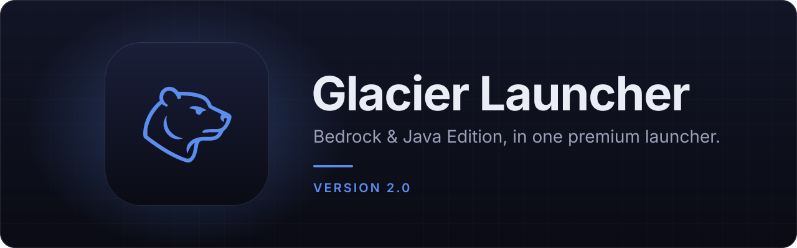
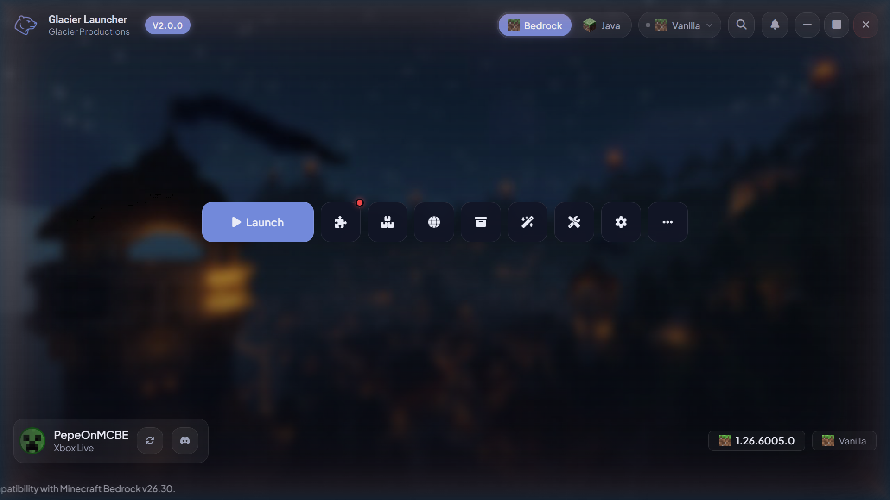
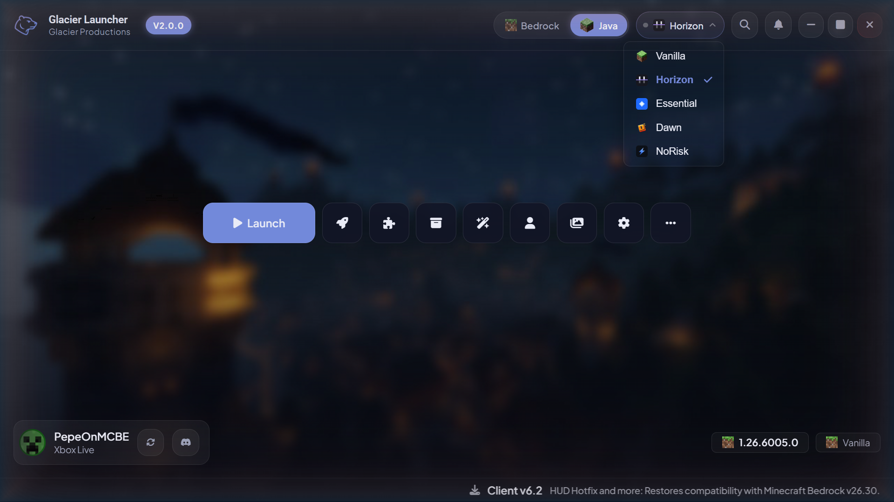
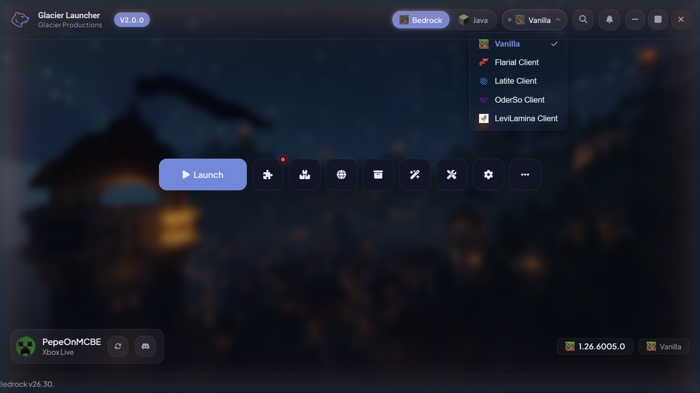
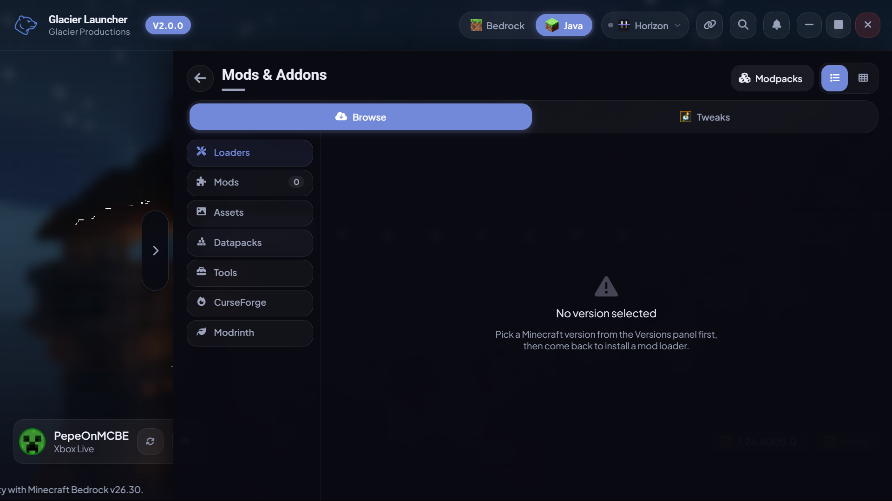
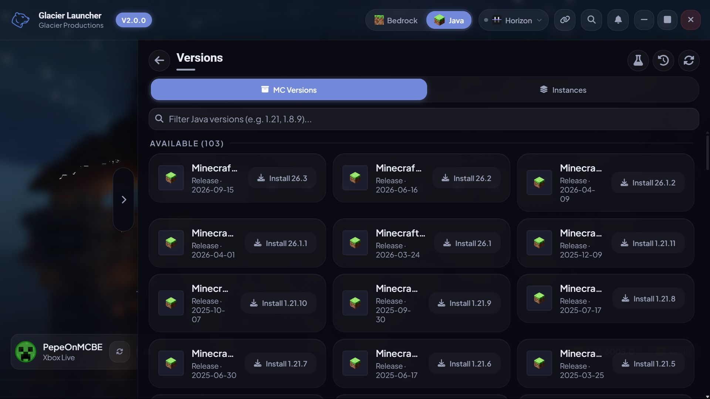

<p align="center">
  
</p>

<p align="center">
  <a href="https://github.com/Glacier-Client-BE/Glacier-Launcher/releases"></a>
  <a href="https://github.com/Glacier-Client-BE/Glacier-Launcher/actions/workflows/ci.yml"></a>
  
  
</p>

<p align="center">
  A fast, frameless Minecraft launcher for <b>Bedrock</b> and <b>Java Edition</b>.<br>
  Clients, versions, mods, worlds and packs, all in one place.
</p>

<p align="center">
  
</p>

## Features

<table>
  <tr>
    <td width="50%" valign="top">
      <h4>Bedrock Edition</h4>
      Install, update and inject DLL clients: Latite, Flarial, OderSo, LeviLamina and Horizon.
      Sideload specific versions or install the current Store build, and manage worlds, packs,
      backups and screenshots, including a <code>level.dat</code> editor.
    </td>
    <td width="50%" valign="top">
      <h4>Java Edition</h4>
      Instances, a version browser, Fabric, Forge and NeoForge loaders, Modrinth and CurseForge
      mods and modpacks, world backups, datapacks and skins. Launch Essential, Dawn and NoRisk as
      standalone mods.
    </td>
  </tr>
  <tr>
    <td valign="top">
      <h4>Client switcher</h4>
      Switch between clients and editions from one toolbar, and open third-party launchers like
      Lunar and Badlion from the same panel.
    </td>
    <td valign="top">
      <h4>Theme Studio</h4>
      A navy default theme matching the Glacier website, plus presets (including Legacy) and
      custom themes you can build, import and export.
    </td>
  </tr>
  <tr>
    <td valign="top">
      <h4>Tweaks and pack sync</h4>
      Pick VanillaTweaks or BedrockTweaks and have them built and installed for you. Share packs
      across instances without losing existing files.
    </td>
    <td valign="top">
      <h4>Light on hardware</h4>
      A native Rust core with a Svelte UI. Animations use only compositor-friendly properties, so
      it stays smooth on low-end laptops. Discord Rich Presence is included.
    </td>
  </tr>
</table>

## Screenshots

<p align="center">
  
  
  
  
</p>

## Install

1. Download `Glacier Launcher_x.y.z_x64-setup.exe` from the [latest release](https://github.com/Glacier-Client-BE/Glacier-Launcher/releases) or the most recent [Build run](https://github.com/Glacier-Client-BE/Glacier-Launcher/actions/workflows/build.yml).
2. Run the installer. It installs for your user only, with no admin rights needed, and asks whether to create desktop and Start Menu shortcuts.
3. Launch Glacier Launcher and pick Bedrock or Java.

Requires Windows 10 or 11 with the WebView2 runtime, which comes preinstalled on Windows 11.

## Development

**Requirements:** Rust (stable), Node 22+, MSVC build tools and WebView2. Testing injection needs an elevated shell.

```bash
cd frontend && npm ci && cd ..
npm run dev        # run the app with hot reload
npm run build      # release exe + NSIS installer in target/release/bundle/nsis
```

Checks that run in CI:

```bash
cargo fmt --all -- --check
cargo clippy --workspace --all-targets -- -D warnings
cargo test --workspace
cd frontend && npx tsc --noEmit -p tsconfig.app.json
```

### Project layout

```
crates/gl-*       library crates: bedrock, java, clients, download, injection,
                  launch, modpack, settings, sync, persistence, nbt, ...
src-tauri/        the app binary: #[tauri::command] wrappers, window chrome, tray, installer
frontend/         Svelte 5 (runes) + Vite + TypeScript, plain CSS
video/            Remotion project for the release video
```

### Conventions

- Register every new `#[tauri::command]` in `generate_handler!` in `src-tauri/src/lib.rs`. Add any new plugin permission to `src-tauri/capabilities/default.json`; without it, the frontend call silently does nothing.
- Global styles live in `frontend/src/app.css`. Search for an existing class before creating one.
- Animate only `transform` and `opacity`.

`PARITY.md` tracks how the Rust rewrite compares with the earlier .NET version it replaces.

---

<p align="center">
  <sub>Made by <a href="https://github.com/Glacier-Client-BE">Glacier Productions</a>.</sub>
</p>
